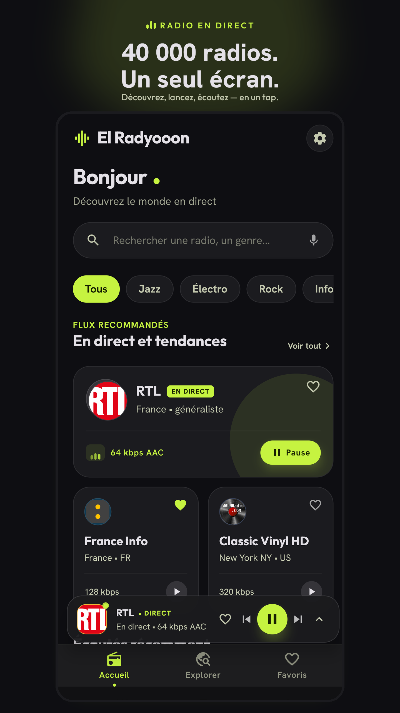
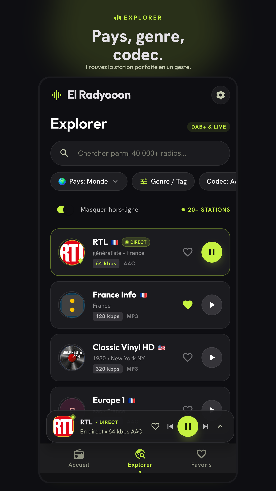
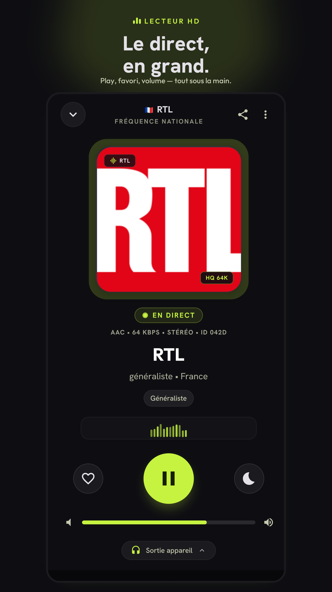

# El Radyooon

Live radio from around the world. Thousands of stations via [Radio Browser](https://www.radio-browser.info/), local favorites and history, a player with a sleep timer, and UI in French, English, and Arabic. No account, no ads.

Mobile app built with **Expo / React Native** (Android, iOS).

## Features

- Home: trending stations, genres, recently played
- Explore: search, country, tags, codecs, hide offline streams
- Player: live playback, volume, sleep timer, share
- Local favorites (sort, export) — nothing is uploaded to your own server
- Persistent mini player and lock-screen controls (native build)
- Languages: Français, English, العربية (RTL applies on the next launch)

Stations are not hardcoded. Everything comes from the Radio Browser API.

## Screenshots

| Home | Explore | Player |
| --- | --- | --- |
|  |  |  |

## Stack

- Expo SDK 57, React Native 0.86, React 19
- `expo-audio` (background playback and media notification)
- Zustand + AsyncStorage
- React Navigation
- Custom i18n + `expo-localization`

Android / iOS package: `com.elradyooon.app`.

## Requirements

- Node 20.19+ (see `.nvmrc`)
- npm
- For a real Android build: Android SDK (`ANDROID_HOME`) and a **phone** emulator (e.g. Pixel) or a device

Expo Go is not enough for lock-screen controls or the native audio service.

## Install

```bash
git clone https://github.com/louaydhyeb/El-Radyooon.git
cd El-Radyooon
npm install
```

## Run

```bash
npx expo start
```

Native Android build (recommended):

```bash
npx expo run:android --device Pixel_10_Pro
```

iOS:

```bash
npx expo run:ios
```

`android/` and `ios/` are generated (Continuous Native Generation) and gitignored. Do not edit them by hand — use `app.json` and config plugins.

## Scripts

| Command | Purpose |
| --- | --- |
| `npm start` | Metro / Expo |
| `npm run android` | `expo run:android` |
| `npm run ios` | `expo run:ios` |
| `npm run lint` | ESLint |
| `npm run format` | Prettier |

## Quality checks

```bash
npx expo lint
npx tsc --noEmit
```

## Play Store build (EAS)

```bash
npx eas-cli@latest build --platform android --profile production
```

The production profile outputs an AAB, with R8 minify and `mapping.txt`.

## Project layout

```
src/
  api/          Radio Browser (DNS failover)
  screens/      Home, Explore, Favorites, Player, Settings
  components/   UI (cards, mini player, nav)
  store/        player, favorites, recents, settings
  i18n/         fr / en / ar + RTL
  services/     expo-audio
```

## Data

- API: [Radio Browser](https://api.radio-browser.info/) (public servers, app User-Agent)
- Favorites, recents, language: AsyncStorage on device only

Some listed streams are dead or unplayable on Android (codec, HTTP, geo-block). “Hide offline” uses Radio Browser’s `lastcheckok` — it is not a guarantee the stream will play.

## License

Personal / project use. Stations and logos belong to their rights holders. See Radio Browser’s terms for the directory API.
